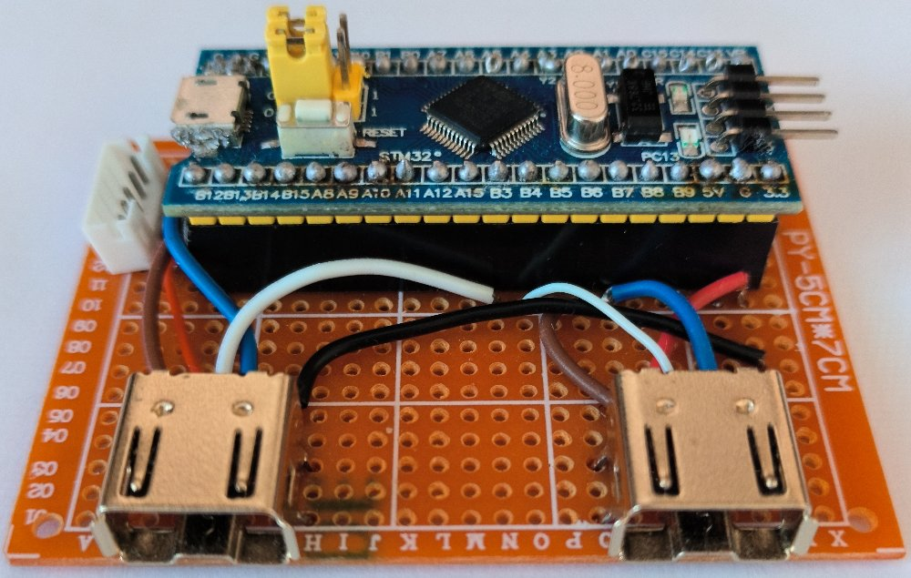

# USBClassicMiniController

USBClassicMiniController is a program for the STM32 [Blue Pill](https://stm32-base.org/boards/STM32F103C8T6-Blue-Pill.html "Blue Pill") boards to create a USB HID interface for Nintendo Classic Mini Controllers.

It uses [LibOpenCM3](https://libopencm3.org/ "LibOpenCM3") library - see the [GitHub](https://github.com/libopencm3/libopencm3 "GitHub") page for more information about compiling the library.

USBClassicMiniController is licensed under [GNU Lesser General Public License version 3](https://www.gnu.org/licenses/lgpl-3.0.html "GNU Lesser General Public License version 3") or later.

---

The device reports itself as PlayStation Classic controller (054c:0cda) in one of three variants depending on the state at start/reset of Blue Pill:

- one controller is connected to Blue Pill (or no controllers are connected):
  - single controller is reported
- two controllers are connected to Blue Pill and BOOT1 jumper is set to 0 (Ground)
  - two controllers are reported (using two endpoints)
  - works on Linux and newer versions of Windows (tested on Windows 11)
  - doesn't work on older versions of Windows (tested on Windows XP)
- two controllers are connected to Blue Pill and BOOT1 jumper is set to 1 (3.3V)
  - two controllers are reported (using single endpoint with Report IDs, each controller is reported at half speed)
  - works on newer and older versions of Windows (tested on Windows 11 and Windows XP)
  - doesn't work on Linux (unless you add `usbhid.quirks=0x054c:0x0cda:0x040` to the file **/boot/cmdline.txt**)

After start/reset you can connect/disconnect controllers (e.g. move controller from one connector to the other one) and the device will continue working.

## Compiling

Use `git clone --recurse-submodules` to clone the repository including the submodule. Or use `git clone` followed by `git submodule update --init --recursive`.

First, compile the library using `make -C libopencm3 TARGETS='stm32/f1'` .

Then, compile the program using `make -C src` .

## Pin connections

This is how the connectors for the controllers are connected to the Blue Pill:

### Controller 1

|Connector Pin #|Connector Pin Name|Blue Pill Pin Name|Blue Pill Pin #|
|:-:|:----:|:-:|:-:|
| 1 |VCC   |3V3|   |
| 2 |SCL   |PB6| 42|
| 3 |Sense |PB4| 40|
| 4 |Unused|   |   |
| 5 |SDA   |PB7| 43|
| 6 |GND   |GND|   |

### Controller 2

|Connector Pin #|Connector Pin Name|Blue Pill Pin Name|Blue Pill Pin #|
|:-:|:-----:|:-:|:-:|
| 1 |VCC   |3V3 |   |
| 2 |SCL   |PB10| 21|
| 3 |Sense |PB3 | 39|
| 4 |Unused|    |   |
| 5 |SDA   |PB11| 22|
| 6 |GND   |GND |   |

In hindsight, using pins PB3 and PB4 for Sense pins wasn't the best choice, because these pins are used for JTAG by default, which must be disabled before the pins can be used for something else.

Using for example pins PB14 and PB15 would have been a better choice.

